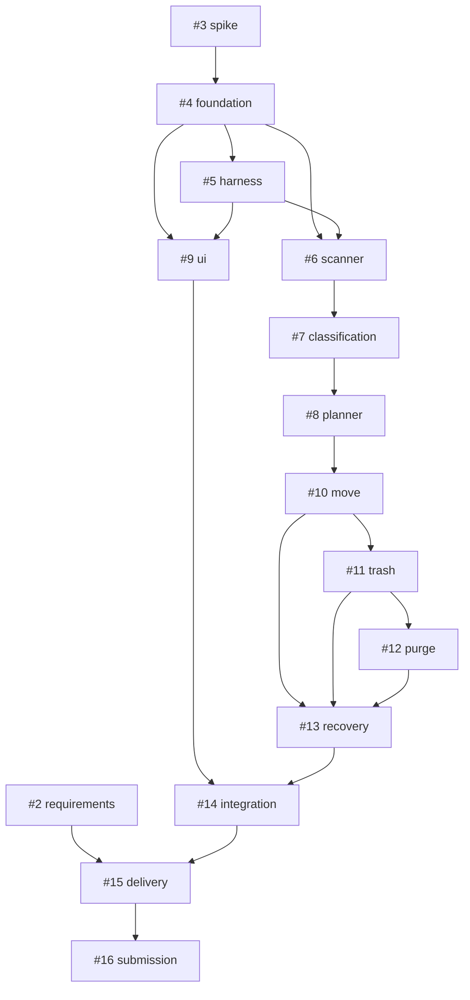

# AFO 핵심 작업 목록

상위 계획: [#1](https://github.com/fakeminjun7321/AFO/issues/1). 핵심 과제 **15개**, 마일스톤 **5개**입니다. 모든 과제는 아직 열린 계획이며 구현·검증 완료를 뜻하지 않습니다.

## 바로 볼 작업

- [#2 사용자·출품·기기 조건](https://github.com/fakeminjun7321/AFO/issues/2)과 [#3 두 OS 기술검증](https://github.com/fakeminjun7321/AFO/issues/3)은 선행 이슈가 없습니다. 현재 계획 승인 범위를 넘어 실행하지 않습니다.
- 기술검증 후 #4 공용 기반, #5 하네스 파일럿을 통과하면 #6 엔진과 #9 화면의 병렬 구현을 시작합니다.
- #2의 교사 답변이 없어도 독립 엔진 설계는 가능하지만 #15 배포·제출 경로 확정은 차단됩니다.
- 제안한 담당 라인은 역할 분담안이며 실제 GitHub assignee는 비어 있습니다. 공동개발자 계정·의사 확인 뒤 배정합니다.

## 과제와 선행 관계

| 이슈 | 결과 | 단계 | 선행 이슈 | 담당 라인 제안 |
| --- | --- | --- | --- | --- |
| [#2](https://github.com/fakeminjun7321/AFO/issues/2) | 사용자 문제·출품 방식·지원 환경 확정 | M0 | 없음 | 공동: 사용자 조사·기획 담당 제안 |
| [#3](https://github.com/fakeminjun7321/AFO/issues/3) | Windows·macOS 파일 작업 기술검증과 아키텍처 결정 | M0 | 없음 | 공동: 엔진 담당 제안 |
| [#4](https://github.com/fakeminjun7321/AFO/issues/4) | 공용 계약·프로젝트 기반·두 OS CI 구축 | M1 | #3 | 개발자 A: 기반 담당 제안 |
| [#5](https://github.com/fakeminjun7321/AFO/issues/5) | 개발 하네스 구성·역할 격리·작은 과제 파일럿 검증 | M1 | #4 | 개발자 A: 조정 담당 제안 |
| [#6](https://github.com/fakeminjun7321/AFO/issues/6) | 선택 폴더의 안전한 스캔·제외 규칙·취소 구현 | M2 | #4, #5 | 개발자 A / core-builder 제안 |
| [#7](https://github.com/fakeminjun7321/AFO/issues/7) | 규칙 기반 분류·내용 해시 중복 탐지 | M2 | #6 | 개발자 A / core-builder 제안 |
| [#8](https://github.com/fakeminjun7321/AFO/issues/8) | 정리 계획·충돌 처리·한 번의 배치 승인 계약 | M2 | #7 | 개발자 A / core-builder 제안 |
| [#9](https://github.com/fakeminjun7321/AFO/issues/9) | 폴더 선택→분석→미리보기→승인→결과 UI | M2 | #4, #5 | 개발자 B / desktop-builder 제안 |
| [#10](https://github.com/fakeminjun7321/AFO/issues/10) | 승인된 폴더 생성·파일 이동·저널·이동 되돌리기 | M2 | #8 | 개발자 A / core-builder 제안 |
| [#11](https://github.com/fakeminjun7321/AFO/issues/11) | 승인한 파일의 실제 OS 휴지통 이동 | M2 | #10 | 개발자 A / core-builder 제안 |
| [#12](https://github.com/fakeminjun7321/AFO/issues/12) | 선택 파일 영구 삭제·실제 공간 관측 | M3 | #11 | 개발자 A / core-builder 제안 |
| [#13](https://github.com/fakeminjun7321/AFO/issues/13) | 중단 복구·동시 실행·파일 변경·데이터 보존 검증 | M3 | #10, #11, #12 | 공동 / verifier + 수정은 core-builder |
| [#14](https://github.com/fakeminjun7321/AFO/issues/14) | Windows·macOS 실제 사용자 경로 통합 검증 | M3 | #9, #13 | 공동: 각 OS 기기 담당 / verifier |
| [#15](https://github.com/fakeminjun7321/AFO/issues/15) | 두 OS 패키징·서명 상태·인정된 산출물 URL 검증 | M4 | #2, #14 | 개발자 B / release 담당 제안 |
| [#16](https://github.com/fakeminjun7321/AFO/issues/16) | 외부 사용자 테스트·5분 소개 영상·최종 제출 점검 | M4 | #15 | 공동: 개발자 B 영상·사용성 담당 제안 |

의존 이슈가 열린 작업에는 `status:blocked`, 선행 이슈가 없는 작업에는 `status:ready` 라벨을 붙였습니다.
Ready는 실제 구현 실행 권한이 아닙니다. 선행 결과를 검토한 뒤 coordinator가 라벨을 갱신하며 자동 실행은 없습니다.

## 의존 그래프

## 마일스톤

- [M0 · 요구·기술 타당성](https://github.com/fakeminjun7321/AFO/milestone/1)
- [M1 · 기반·하네스](https://github.com/fakeminjun7321/AFO/milestone/2)
- [M2 · 핵심 경로](https://github.com/fakeminjun7321/AFO/milestone/3)
- [M3 · 삭제·복구·양 OS](https://github.com/fakeminjun7321/AFO/milestone/4)
- [M4 · 패키징·대회 제출](https://github.com/fakeminjun7321/AFO/milestone/5)

날짜는 [PLAN.md](PLAN.md)의 목표 일정입니다. 외부 답변·기기·플랫폼 한계가 생기면 차단 원인과 조정 내용을 이슈에 남깁니다.

## 구현을 시작할 때

1. 구현 시작 지시를 받은 뒤 #2/#3의 실제 담당과 기기를 정합니다.
2. 각 이슈의 목표·경로·완료 조건·검증 증거를 작업 패킷으로 전달합니다.
3. 커밋·실제 명령·결과를 검증한 PR만 사람이 병합합니다.
4. 상위 계획의 체크리스트와 하위 이슈는 실제 완료 근거가 생겼을 때만 닫습니다.

## 후속 범위

상시 감시·예약 정리, 내용 의미 기반 AI 분류, 클라우드 연동, 전체 디스크/캐시 청소, 교차 볼륨 이동은 첫 버전의 핵심 이슈에 섞지 않습니다. 필요하면 별도 제안 이슈로 만듭니다.
